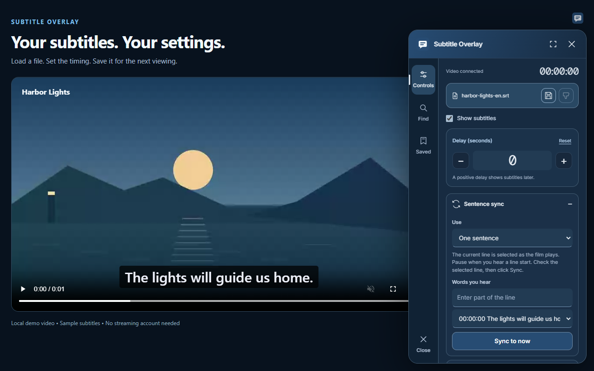

# Subtitle Overlay

Read. Sync. Watch.

Add your own subtitles to browser video. Find a subtitle, set its timing, and change how it looks. Save the file and its settings for the next viewing.



## New Design

Saved subtitles has separate Films and Shows views. Shows use show, season, and episode selectors. Older saved episode titles are recognized without changing stored files.

Version 0.8.10 keeps the popup and video controller search fields in sync. Saved searches cannot replace the detected film.

Version 0.8.10 uses a shared tool rail, fixed popup file actions, and a clearer timing card. See [design notes and research](docs/design/NEW-DESIGN.md).

## Features

- Group player subtitle tracks by language. See each language name and track count. Filter the list before Import.
- Import readable player lines, text style, and position. Restore player style from Text style.
- Lift bottom subtitles above visible player controls. Keep the chosen position and timing.
- Load SRT, WebVTT, ASS, SSA, and text SUB files. Open ZIP and gzip files.
- Search OpenSubtitles through its website or API.
- Get a film or show suggestion from player metadata. For a series, include the season, episode number, and readable episode name. Edit it before you search.
- Select a subtitle language from a named list.
- Adjust the delay. Sync with one, two, or three sentences.
- Change the font, size, color, background, and shadow.
- Save subtitles and their timing and text settings on this device.

## Install

Version 0.8.10 is the current stable release. A Chrome Web Store listing is not available yet.

1. Download this repository or a release ZIP. Extract the files.
2. Open `chrome://extensions`. In Edge, open `edge://extensions`.
3. Turn on **Developer mode**.
4. Select **Load unpacked**. Select the `extension` folder.
5. Open a video page. Select the extension, then **Show overlay**.
6. Select **Load file**, or use **Find** to search for a subtitle.

Chrome is the main target. Edge and Vivaldi use the same extension format. The publisher confirmed Disney+ playback, seeking, and sentence sync in Vivaldi on Windows with version 0.7.10. Other player and browser combinations still need testing.

## Sync a subtitle

1. Open **Sentence sync**. Select one, two, or three sentences.
2. Pause when a sentence starts. Check the selected sentence.
3. Select **Sync to now**, or set the first point.
4. For two or three sentences, repeat at later sentences.
5. Select the **Save** icon to keep the subtitle and its settings.

One sentence sets the delay. Two or three sentences also correct steady timing drift. Different film edits can still need another subtitle file.

## Files and downloads

Local files need no account. Website search needs no extension API key. API search needs your OpenSubtitles key. Some provider actions also need an account.

Website downloads go to `Subtitle Overlay` inside your browser's download folder. They also load into the film tab and local subtitle library. Complete any website step or browser Save prompt first. Closing the search window stops tracking.

The library stays on this device. Deleting a library item does not delete files in your download folder. See the [user guide](docs/USER-GUIDE.md).

## Limits

- A video must expose a readable clock or public playback timeline. Show the player controls if the overlay asks for the time.
- Closed shadow roots and inaccessible frames can prevent player access.
- ASS and SSA text and timing are supported. Embedded styles and effects are not rendered.
- Image subtitles, RAR files, encrypted ZIP files, and archives over the 2 MB limit are not supported.
- Authenticated OpenSubtitles delivery still needs confirmation for version 0.8.10.

## Import player subtitles

Open **Find → Player subtitles**. Select a language. **Import** loads its subtitle file if no lines are readable, or copies loaded text and timing into the overlay. You can then change timing and text style, sync with sentences, and save the result.

Only public subtitle or caption tracks are listed. A track can say **not loaded** until you select **Import**. The extension then requests its file URL through normal browser access. SRT, WebVTT, ASS, and SSA text are supported. A blocked file reports an error; select another track or load a local file. Some players use a separate caption renderer and expose no readable tracks. Select a language in the player, then **Refresh**. Streaming tracks may expose only loaded lines. Import again to make a new copy if more lines load. Import also copies readable player text style and position. In **Text style**, select **Restore player style** to restore the captured appearance without changing timing or sentence-sync points. Save keeps this original style with your settings. Browser-drawn styles, multiple shadows, animations, and per-line effects may not be readable.

## Update an unpacked install

Replace the files in the same extension folder. Select **Reload** on its browser extension card. Refresh the film tab. Keep the same folder to retain the extension's local library.

## Development

```sh
npm ci
npx playwright install chromium
npm run check
npm test
npm run build
```

The extension has no runtime npm dependencies. Tests use Playwright and local fixtures. The build creates a Chrome Web Store ZIP with `manifest.json` at its root. See [development](docs/DEVELOPMENT.md) and [release preparation](docs/RELEASE.md).

## Support development

The extension is free to use. Select **Tip** in the popup, or visit [the support page](https://yahyanabil.com/support). Tips are optional.

## Project links

[Privacy](docs/PRIVACY.md) · [Support](SUPPORT.md) · [Changes](CHANGELOG.md) · [Contribute](CONTRIBUTING.md)

Publisher: `yahyaint`. Repository: [`yahyaint/subtitle-overlay`](https://github.com/yahyaint/subtitle-overlay). License: [MIT](LICENSE).

Player subtitles is the first panel in Find. Track events and video changes trigger a quick update. Custom caption links and public Video.js, JW Player, and Artplayer caption files are supported. Open shadow roots are included. Files load only after Import. Some players expose no subtitle files; cross-origin frame players require a separate integration.
